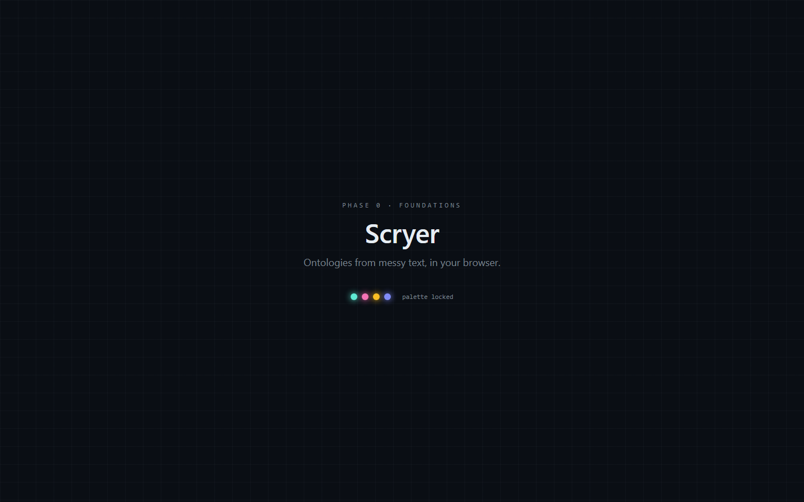
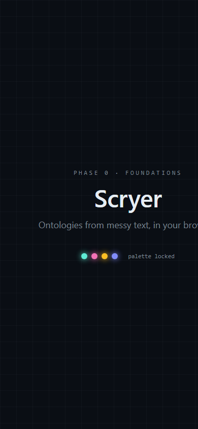

# QA Report: Scryer Phase 1

| Field | Value |
|-------|-------|
| **Date** | 2026-11-08 |
| **URL** | http://localhost:5173/scryer/ |
| **Branch** | `main` |
| **Commit** | `d633fc6` (`[phase-0] commit canonical implementation plan`) |
| **PR** | — |
| **Tier** | Exhaustive against the Phase 1 acceptance criteria |
| **Scope** | Phase 1 static shell, desktop, responsive/mobile, controls, graph/document/query surfaces, shortcuts, console, and build |
| **Duration** | 18 minutes |
| **Pages visited** | 1 SPA route at desktop and mobile widths |
| **Screenshots** | 2 |
| **Framework** | Vite + React + TypeScript |

## Verdict

**Phase 1 is not running and is not present on the checked-out repository refs.** The target returns HTTP 200, the production build succeeds, the documented color tokens are loaded, and the console is clean. However, both the live app and a hard reload render only the Phase 0 “Foundations” splash. The repository has only `main`, with Phase 0 commits and no `[phase-1]` commit on any ref.

Phase 1 acceptance coverage: **1/10**. Only the dark palette/tokens are observable.

## Health Score: 61/100

| Category | Score | Evidence |
|----------|------:|----------|
| Console | 100 | No warnings or errors before or after interactions |
| Links | 100 | No broken links; the page exposes no links |
| Visual | 47 | Phase 1 shell/graph styling absent; mobile copy clips |
| Functional | 0 | Controls, panels, graph, document viewer, query input, shortcuts, and mobile tabs are absent |
| UX | 42 | No usable Phase 1 workflow; mobile phase gate fails |
| Performance | 100 | Production build succeeds; Phase 1 runtime performance cannot be assessed because its UI is absent |
| Content | 70 | Page explicitly identifies itself as Phase 0 and has no document content |
| Accessibility | 77 | Expected interactive controls cannot be assessed because they do not exist; mobile text is clipped |

Weighted score: `(100×.15) + (100×.10) + (47×.10) + (0×.20) + (42×.15) + (100×.10) + (70×.05) + (77×.15) = 61.05`.

## Phase 1 Acceptance Matrix

| Requirement from `docs/scryer-implementation-plan.md` | Result | Evidence |
|--------------------------------------------------------|--------|----------|
| Three-panel desktop layout | **FAIL** | Only centered Phase 0 splash is rendered |
| Dark theme from `tokens.css` | **PASS** | All ten documented color tokens match the plan |
| Topbar: scenario picker, mode toggle, speed control | **FAIL** | 0 buttons, 0 selects, 0 navigation elements |
| Status strip | **FAIL** | No status content or region |
| Cytoscape hardcoded four-node graph | **FAIL** | 0 canvas elements and no graph UI |
| Document viewer renders markdown with Shiki | **FAIL** | No document viewer or document content |
| Query panel accepts input | **FAIL** | 0 inputs and 0 textareas |
| Keyboard shortcuts `1/2/3`, `space`, `/` | **FAIL** | Every key left focus on `BODY` and produced no state/text change |
| Mobile tabs switch panels | **FAIL** | 0 tabs, 0 tablists, and 0 buttons at mobile width |
| Mobile shell looks premium without data | **FAIL** | Phase 0 splash is shown; tagline clips at 390px |

## Top 3 Things to Fix

1. **ISSUE-001: The target serves Phase 0, not Phase 1** — the current branch, all refs, and live localhost route contain no observable Phase 1 implementation.
2. **ISSUE-003: Core graph/document/query surfaces are absent** — the main Phase 1 product surfaces cannot be exercised.
3. **ISSUE-005: Mobile tab layout is absent** — the required responsive interaction and phase gate cannot be tested or passed.

## Console Health

No console warnings or errors were captured during load, hard reload, keyboard interaction, or responsive checks.

## Build and Test Health

- `npm run build`: **PASS** (`tsc -b && vite build`, 27 modules transformed).
- Production bundle: 144.76 kB JavaScript / 46.57 kB gzip; 7.00 kB CSS / 2.51 kB gzip.
- HTTP probe: **200**, `text/html`, 904 bytes, Phase 0 marker present.
- No test framework or test files were detected. Run `/qa` to bootstrap one and enable regression test generation.

## Summary

| Severity | Count |
|----------|------:|
| Critical | 3 |
| High | 2 |
| Medium | 1 |
| Low | 0 |
| **Total** | **6** |

## Issues

### ISSUE-001: The running target is still Phase 0

| Field | Value |
|-------|-------|
| **Severity** | Critical |
| **Category** | Functional |
| **URL** | http://localhost:5173/scryer/ |

**Description:** The expected Phase 1 static shell is not served. A hard reload still displays `PHASE 0 · FOUNDATIONS`, and the DOM contains only the splash heading and supporting copy.

**Repro Steps:**

1. Navigate to the target URL and hard reload.
2. Observe the phase label and centered splash.
3. **Expected:** Phase 1 three-panel application shell. **Actual:** Phase 0 splash.

---

### ISSUE-002: Topbar, three panels, and status strip are absent

| Field | Value |
|-------|-------|
| **Severity** | High |
| **Category** | Visual |
| **URL** | http://localhost:5173/scryer/ |

**Description:** The desktop acceptance layout is missing. Browser inspection found 0 buttons, 0 selects, 0 navigation elements, and no panel/status regions.

**Repro Steps:**

1. Open the target at desktop width.
2. Inspect the full viewport.
3. **Expected:** 52px topbar, 24/52/24 panels, and 32px status strip. **Actual:** centered splash only.

---

### ISSUE-003: Graph, document viewer, and query panel are absent

| Field | Value |
|-------|-------|
| **Severity** | Critical |
| **Category** | Functional |
| **URL** | http://localhost:5173/scryer/ |

**Description:** None of the three core Phase 1 surfaces exist. Inspection found 0 canvases, 0 inputs, and 0 textareas; no document content is rendered.

**Repro Steps:**

1. Open the target at desktop width.
2. Look for the document, graph, and query regions.
3. **Expected:** Shiki document view, four-node Cytoscape graph, and editable query input. **Actual:** all three are absent.

---

### ISSUE-004: Keyboard shortcuts are inert

| Field | Value |
|-------|-------|
| **Severity** | High |
| **Category** | Functional |
| **URL** | http://localhost:5173/scryer/ |

**Description:** Pressing `1`, `2`, `3`, `space`, and `/` produces no observable state or text change. Focus remains on `BODY`; `/` does not focus a query input because no query input exists.

**Repro Steps:**

1. Open the target and press each documented shortcut.
2. Observe focus and page state after every key.
3. **Expected:** scenario selection/replay/query focus scaffolding. **Actual:** no effect.

---

### ISSUE-005: Mobile tabs and graph panel are absent

| Field | Value |
|-------|-------|
| **Severity** | Critical |
| **Category** | UX |
| **URL** | http://localhost:5173/scryer/ |

**Description:** At a 390×844 mobile viewport, the app contains 0 tabs, 0 tablists, 0 buttons, and 0 canvases. The required panel switching and 70vh graph experience do not exist.

**Repro Steps:**

1. Open the target at 390×844.
2. Look for Document, Graph, and Query tabs.
3. **Expected:** three mobile tabs with a switchable graph panel. **Actual:** Phase 0 splash only.

---

### ISSUE-006: Mobile tagline clips outside the viewport

| Field | Value |
|-------|-------|
| **Severity** | Medium |
| **Category** | Visual |
| **URL** | http://localhost:5173/scryer/ |

**Description:** At 390px wide, the sentence “Ontologies from messy text, in your browser.” runs past the right viewport edge and is visibly clipped. The current empty-shell mobile phase gate therefore fails even before the Phase 1 panels are considered.

**Repro Steps:**

1. Open the target at 390×844.
2. Inspect the line below the Scryer heading.
3. **Expected:** complete, readable copy contained in the viewport. **Actual:** text is truncated on the right.

## Fixes Applied

None. This was a report-only verification run; application code was not changed.

## Regression Tests

No automated test framework exists in the repository, so no regression tests could be run or generated in report-only mode.

## Ship Readiness

| Metric | Value |
|--------|-------|
| Health score | 61/100 |
| Phase 1 acceptance coverage | 1/10 |
| Issues found | 6 |
| Fixes applied | 0 |
| Phase gate | **FAIL** |

**Release status:** Not ready to declare Phase 1 complete. The live local route and all local Git refs remain at Phase 0.
